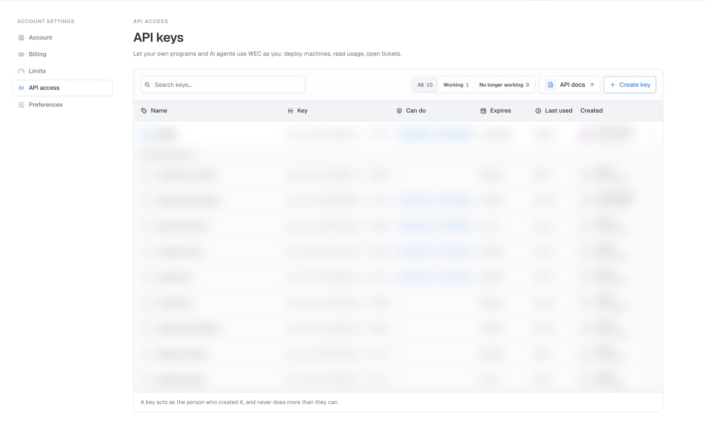
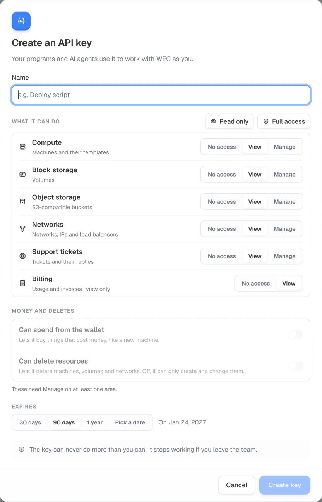

# gowec

The WEC cloud from your terminal. `gowec` manages VMs, storage, networks,
plans and tickets through the public API (`/api/public/v1`) with an account
API key.

It works two ways:
- **Interactive console:** run `gowec` alone.
- **One-shot commands:** `gowec vm start web-1`, for scripts and CI.

> **Prepaid accounts.** gowec works with prepaid WEC accounts, through the public
> API at `https://prepaid-cloudapi.wiline.com`.

---

## Contents

- [Install](#install)
- [Log in](#log-in)
- [The console](#the-console)
- [How commands read](#how-commands-read)
- [Commands](#commands)
- [Spending and deleting](#spending-and-deleting)
- [Output, errors and exit codes](#output-errors-and-exit-codes)
- [Scripts and CI](#scripts-and-ci)
- [Known limits](#known-limits)
- [Development](#development)
- [License](#license)

---

## Install

On macOS or Linux:

```bash
curl -fsSL https://github.com/WiLine-Edge-Cloud/gowec/releases/latest/download/install.sh | sh
```

The script downloads the latest build for your system, checks it against the release's checksums, and asks where to install it:

```
Install gowec in [/usr/local/bin]:
```

- **Press Enter** for `/usr/local/bin`. It's already on your `PATH`, so `gowec` works straight away. On most Macs that folder needs administrator rights, so `sudo` asks for your password.
- **Type another folder** to install without a password, such as `~/.local/bin`. If it isn't on your `PATH`, the script prints the line that adds it:

  ```bash
  echo 'export PATH="$HOME/.local/bin:$PATH"' >> ~/.zshrc && source ~/.zshrc
  ```

  With bash, use `~/.bashrc` instead of `~/.zshrc`.

Then check it runs with `gowec version`.

- **A specific version:** `curl -fsSL …/install.sh | GOWEC_VERSION=v0.1.0 sh`
- **No question** (scripts and CI): `curl -fsSL …/install.sh | GOWEC_INSTALL_DIR=~/bin sh`. Without a terminal it doesn't ask: it uses `/usr/local/bin` when writable, else `~/.local/bin`.
- **Windows:** download [gowec_windows_amd64.zip](https://github.com/WiLine-Edge-Cloud/gowec/releases/latest/download/gowec_windows_amd64.zip) and put `gowec.exe` on your `PATH`.
- **From source,** with Go 1.27 or newer: `make build`, then put `bin/gowec` on your `PATH`.

**Updating.** Run the same `curl … | sh` line again: it replaces `gowec` with the latest release. Your contexts and keys in `~/.config/gowec/` are kept. `gowec version` shows what you have, and the [releases page](https://github.com/WiLine-Edge-Cloud/gowec/releases) lists what changed in each version. On Windows, download the new zip and replace `gowec.exe`.

For shell completion outside the console, add the script for your shell:

```bash
gowec completion zsh > "${fpath[1]}/_gowec"      # bash, fish and powershell work too
```

## Log in

1. **Open API keys** in the WEC portal: **Settings → API access**, then **Create key**.

   

2. **Choose what the key can do.**
   - **Name:** something you'll recognise later, such as "gowec on my laptop".
   - **What it can do:** **Read only** lets gowec look but not change anything. To start, stop or create things, set **Manage** on those areas, or pick **Full access**.
   - **Money and deletes:** turn on **Can spend from the wallet** for commands that charge, such as `vm create`, `plan upgrade` and `plan addon add`. Turn on **Can delete resources** for `delete` and `release` commands. Both need **Manage** on at least one area.
   - **Expires:** 30 days, 90 days, 1 year or a date. Create a new key before it runs out.

   

   The key acts as you and can never do more than you can. It stops working if you leave the team.

3. **Copy the key.** It's shown once, and it starts with `wec_`.
4. **Save it in gowec.** gowec checks the key against the API before saving it.

```bash
gowec auth login                                   # asks for the key (hidden); context "default"
gowec auth login --context work                    # a second account, saved separately
echo "$WEC_KEY" | gowec auth login --token-stdin   # no prompt
gowec auth status                                  # account, permissions, guards, expiry
gowec auth logout                                  # forget the saved key (it stays valid)
```

**Contexts.** Each key is saved under a *context*: an API host plus a key.
- Contexts live in `~/.config/gowec/config.yaml`, readable by you only (mode 0600).
- `gowec context list` lists them, and `gowec context use <name>` switches.
- The default host is the prepaid deployment, `https://prepaid-cloudapi.wiline.com`.

| Environment variable | What it does |
|---|---|
| `GOWEC_TOKEN` | Uses this key instead of the saved one, with no config file |
| `GOWEC_API_URL` | Uses this API host |
| `GOWEC_CONTEXT` | Picks a context (same as `--context`) |
| `GOWEC_CONFIG` | Keeps the config somewhere else |
| `NO_COLOR` | Turns colours off |

`auth status` warns in red when the key expires within a week.

## The console

Run `gowec` with no arguments on a terminal.

1. It shows the name, the version, and a status line: the context, account, key and its expiry.
2. Then a prompt appears:

```
 gowec local › vm list
```

**Inside the console**
- Type any command without the `gowec` prefix. If you type it out of habit (or paste a line from these docs), it is ignored.
- Help, examples and hints inside the console drop the prefix too, so what they show is what you type. Outside it they keep `gowec`.
- **Tab** completes commands, flags and names: VMs, volumes, networks, VPCs, addresses, ACLs, security groups, tickets, plans.
- History is kept in `~/.config/gowec/history`.
- **Ctrl-C** stops the running command or wait, and keeps the console open.
- **Ctrl-D**, `exit` or `quit` leaves.
- `clear` clears the screen, and `help` lists the commands.
- Logging in or switching context updates the prompt.

## How commands read

```
gowec <resource> <action> [target] [flags]
```

- **Targets are names or ids.** Name lookup ignores case.
  - Addresses also take the IP.
  - Tickets take their number (as in the emails) or their id.
  - ACL rules take their number.
- **Unknown or ambiguous names fail.** The error lists the names that exist, or the ids that match, so you can pick one.
- **Resource names have aliases.** Every resource accepts its plural, plus short forms: `machine` and `instance` for `vm`, `vol`, `ip`, `fw`, `ctx`.

`gowec --help` and `gowec <resource> --help` show every command, its flags (required ones first) and examples.

## Commands

### VMs

```bash
gowec vm list                         # the instances table (below)
gowec vm list --status stopped -q     # ids only
gowec vm get web-1                    # everything about one VM
gowec vm start web-1                  # waits until WEC is done
gowec vm stop web-1 --force           # pull the plug
gowec vm reboot web-1 -d              # detach: print the job id instead of waiting
gowec vm resize web-1 --size wa-gnp-1.2c-4gb
gowec vm rename web-1 --name api-1
gowec vm delete web-1
gowec vm create --name web-2 --zone princeton --template "Ubuntu 24.04 LTS" \
  --size wa-gnp-1.1c-0.5gb --disk 20 --network Default-Subnet --term 12 --backups
```

`vm list` matches the portal's instances table. Each VM takes two lines:

```
NAME                         RESOURCES               USAGE 24H              STATUS      PUBLIC IP     BACKUPS     PRICE        RENEWAL
hardy-tiger-b564 Basic AMD   2 vCPU · 4 GB           ▁▂▁▁█▁▁▁▁▁▁▁ 0% cpu    ▶ Running   No address    ✓ Daily     $30.76/mo    Renews Oct 14, 2027
Ubuntu 24.04 LTS             50 GB disk · 2000 MHz                8% mem                                  $369.12/yr   in 364 days
```

| Column | What it shows |
|---|---|
| Name | The tier (Basic, High Performance, Enterprise, AI Optimized) and CPU vendor, then the OS |
| Resources | Size, disk and CPU speed |
| Usage 24h | A CPU sparkline for the last day, with current CPU and memory |
| Status, zone, address, backups | As in the portal |
| Price | The plan's monthly cost with its add-ons, plus the term total |
| Renewal | "Renews …", or "Ends …" in amber when the plan won't renew, with days left |

- **Narrow terminals:** columns drop until the table fits, least useful first. Zone goes first when every VM is in the same zone.
- **Missing data:** if plans or usage can't be read (for example, a key without billing view), those cells show "—" and the list still appears.

### Plans (prepaid)

On prepaid, every VM runs on a plan: 1, 12 or 24 months, paid from the wallet up front.

```bash
gowec plan list                               # plans still running; --all adds ended ones
gowec plan quote --size wa-gnp-1.1c-0.5gb --disk 20
gowec plan upgrade web-1 --term 12            # longer term; charges the difference
gowec plan addon quote web-1                  # what backups and an address cost on this plan
gowec plan addon add web-1 backups
gowec plan addon add web-1 address --network Default-Subnet
gowec plan addon remove web-1 address         # the days left are refunded
gowec plan delete-now <plan-id>               # delete the VM and its plan now
```

- **Naming a plan:** any command that takes a plan also takes the VM's name.
- **`plan delete-now`** refunds the unused days to the wallet within about a minute. Data volumes are kept, detached.

### Storage

Volumes:

```bash
gowec volume list
gowec volume get data-1
gowec volume create --name data-1 --zone princeton --offering s-nvme-1-50gb --term 12   # prepaid: a plan of its own
gowec volume create --name scratch --zone princeton --offering Custom --size 200 --vm web-1
gowec volume attach data-1 --vm web-1
gowec volume detach data-1
gowec volume resize data-1 --size 100
gowec volume delete data-1
```

Snapshots of a volume, snapshots of a whole VM, and snapshot schedules:

```bash
gowec snapshot create data-1 --name before-upgrade
gowec snapshot list --volume data-1
gowec snapshot revert before-upgrade
gowec snapshot delete before-upgrade
gowec snapshot vm create web-1 --name pre-deploy --memory
gowec snapshot policy create data-1 --interval daily --at 03:00 --keep 7
gowec snapshot policy list
```

Backups and backup schedules:

```bash
gowec backup list --vm web-1
gowec backup create web-1
gowec backup restore <backup-id>              # overwrites the VM's disks
gowec backup enable web-1                     # a VM on a plan: gowec plan addon add web-1 backups
gowec backup disable web-1 --delete-backups
gowec backup schedule create web-1 --interval weekly --at 23:30 --day sun --keep 4
gowec backup offering list
```

Schedules take `--interval` (hourly, daily, weekly or monthly) and `--at`:
- `--at HH:MM` gives the time; for hourly, give only the minute.
- Weekly schedules also need `--day` with a weekday (`mon` … `sun`).
- Monthly schedules also need `--day` with a day of the month (1–28).
- Times are UTC unless you pass `--timezone`.

### Networking

```bash
gowec vpc list                                # with its networks and source NAT address
gowec vpc get prod
gowec network list --vpc prod
gowec network rules Default-Subnet
gowec network offering list                   # the kinds of network --offering takes
gowec vpc offering list
gowec vpc create --name prod --zone princeton --cidr 10.1.0.0/16 --offering "Default VPC offering"
gowec address list
gowec address allocate --vpc prod --vm web-1
gowec address attach 203.0.113.10 --vm web-1     # static NAT
gowec address detach 203.0.113.10
gowec address release 203.0.113.10
```

Firewall: network ACLs and their rules, and security groups:

```bash
gowec firewall acl list
gowec firewall acl create --vpc prod --name web-acl
gowec firewall acl rules web-acl                       # in the order they apply
gowec firewall acl rule add web-acl --protocol tcp --port 443 --number 10
gowec firewall acl rule update web-acl 10 --action deny   # flags left out keep their value
gowec firewall acl rule move web-acl 20 --before 10
gowec firewall acl rule delete web-acl 20
gowec firewall sg create --name web
gowec firewall sg rule add web --protocol tcp --port 22 --cidr 203.0.113.0/24
gowec firewall sg rules web
```

A rule without `--cidr` applies to any address.

Renaming, restarting and deleting:
- `network` and `vpc` both have `rename`, `restart` and `delete`.
- `vpc` also has `source-nat`, which changes the address outbound traffic leaves from.
- A restart briefly interrupts traffic for every VM on that network or VPC.

### Account

```bash
gowec wallet show
gowec wallet transactions --limit 20
gowec ssh-key add --name laptop --public-key-file ~/.ssh/id_ed25519.pub
gowec ssh-key list
gowec ticket list --since 2026-09-01
gowec ticket get 781450
gowec ticket create --title "Need more backups" --message "…"
gowec ticket comment 781450 --message "…"
```

### Catalog

```bash
gowec zone list
gowec size list --zone princeton
gowec template list --zone princeton
gowec disk list
gowec price list                  # sizes and their prices
gowec bundle list --zone princeton
```

### Following background work

Long actions return an id. Commands wait by default; `-d` (`--detach`) prints the id instead. You can follow it later:

```bash
gowec job wait <job-id>            # WEC actions: start, stop, attach, …
gowec launch wait <launch-id>      # VM launches
gowec upgrade wait <upgrade-id>    # plan upgrades
```

Each of these also has `get`, which shows the current state once without waiting.

## Spending and deleting

Every command that charges the wallet or destroys something asks first.

**Paid commands quote first.** These commands get the price, show a summary, and only then ask:
- `vm create`
- `volume create --term`
- `plan upgrade`
- `plan addon add`

`address allocate` and `backup enable` also price the charge before asking: the question says what the wallet is charged for the first month, or that the VM's plan already includes it.

```
VM       web-2
Size     wa-gnp-1.1c-0.5gb
Term     12 months
Total    $29.28  ($2.44 a month)

? Launch web-2 and charge $29.28 to the wallet? [y/N]
```

**Other paid or destructive commands ask without a quote:**
- deletes, releases, restores and reverts;
- `vm resize`.

**Without a terminal, gowec never guesses.** Every one of these refuses unless you pass `--yes`.

**A price ceiling.** Paid commands that quote also accept `--max-price N`:
- at or below that price, they go ahead without asking;
- above it, they refuse and nothing is charged.

**A price that changes is never accepted for you.** If the price changes between the quote and the purchase, the API refuses the purchase and nothing is charged. gowec shows the new price and stops; it never re-sends at the new price on its own.

**Retries never charge twice.** Every paid call carries an `Idempotency-Key`, so if gowec retries after a network failure, the API repeats its first answer instead of charging again.

**Deleting a VM on a plan.** A prepaid VM is deleted together with its plan, so `vm delete` refuses and prints the command to use:

```
! web-2 runs on a plan, so it is deleted with its plan.
  → gowec plan delete-now b550e80c-…   (its unused days go back to the wallet)
```

gowec never turns one into the other for you, because a plan delete moves money.

## Output, errors and exit codes

| Flag | Output |
|---|---|
| `-o table` (default) | Tables and detail views for people |
| `-o json`, `-o yaml` | The API's own objects, unchanged |
| `-q` | Ids only, one per line |

- **Colours** are off when output is piped or `NO_COLOR` is set.
- **Spinners and the banner** only appear on a terminal.

**Errors** show the API's message and code, then any names to choose from, then a hint for the next step. Last comes the request id to quote to support:

```
✗ No size is called 'huge' (unknown_size)
  available: wa-gnp-1.1c-0.5gb, wa-gnp-1.1c-1gb, …
  request 1d9c3372-… · quote it to support
```

| Exit code | Meaning |
|---|---|
| 0 | It worked |
| 1 | The API refused, a job failed, or you answered no |
| 2 | The command was wrong (unknown command or flag, missing argument), or it needs `--yes` |
| 130 | Interrupted |

## Scripts and CI

```bash
export GOWEC_TOKEN=wec_live_…            # no config file needed
gowec vm list --status running -q | while read id; do
  gowec vm reboot "$id" -d
done

gowec vm create --name ci-runner --zone princeton --template "Ubuntu 24.04 LTS" \
  --size wa-gnp-1.1c-1gb --disk 20 --network Default-Subnet --max-price 7 -o json
```

- **Retries:** gowec retries rate limits (respecting `Retry-After`) and brief outages.
- **Request cost:** use `-o json` in loops. The `vm list` table makes four API calls (VMs, plans, volumes, usage), while JSON makes one.

## Known limits

These come from the public API, not from gowec:

- **VM snapshots aren't available yet.** The storage behind them doesn't support them yet, so WEC refuses them with an error.
- **Prepaid data volumes can only be bought.** Resizing or removing one goes through the portal.
- **`price list` shows the raw billing figures** for sizes only. Add-on prices appear in `plan addon quote` and `bundle list`.

## Development

| Path | What's in it |
|---|---|
| `pkg/wec/` | The SDK: client, retries, errors, paging, waiting, one file per resource. It has no CLI code, so a future Terraform provider can use it. |
| `internal/cli/` | The commands: one file per resource; `root.go` registers them; `help.go` draws the help. |
| `internal/shell/` | The interactive console: line editing, completion, history. |
| `internal/ui/` | Colours, the banner, tables, the spinner and prompts. |
| `internal/config/` | The contexts file and the `GOWEC_*` variables. |
| `cmd/gowec/` | `main`. The version is set at build time with `-X main.version`. |

```bash
make build    # bin/gowec
make test     # go test ./...
make vet
make dist     # a release build of every platform in dist/ (needs goreleaser); uploads nothing
```

**Adding a command:**
1. Add the call to `pkg/wec`.
2. Add a command under its resource in `internal/cli`, using the shared helpers:
   - `r.show` for output;
   - `r.confirm` before spending or deleting;
   - `r.waitJob` for jobs;
   - `r.idempotencyKey` for paid calls;
   - `r.completeNames` for tab completion;
   - `ui.Table`, `ui.RowTable` and `ui.Pairs` for tables and detail views.
3. Follow the rules in [Spending and deleting](#spending-and-deleting) for anything that charges or destroys.
4. Try it on a test account before anything that charges.

**Tests are kept small.** Only the money logic has unit tests: idempotent retries, the error shape, quote totals. Prices themselves come from the API's quotes. Check everything else in the running app. `--api-url` points a context at another API host, such as a local server:

```bash
gowec auth login --context dev --api-url http://localhost:5050
```

Paid commands spend real wallet money, so run them deliberately.

gowec uses only the public API. A feature that needs something the API doesn't offer starts with a new API endpoint.

### Releasing a new version

A pushed tag that starts with `v` publishes a release. The release workflow (`.github/workflows/release.yml`) runs vet and the tests, builds macOS, Linux and Windows with GoReleaser (`.goreleaser.yaml`), and publishes a GitHub Release with the archives, `checksums.txt`, `install.sh` and notes from the commits. Every push to `main` and every pull request runs vet, the tests and a check of the release config (`.github/workflows/ci.yml`).

1. **Land the changes on `main`** and wait for its `ci` run to pass.

   ```bash
   git push origin main
   ```

2. **Pick the version.** Versions follow [semantic versioning](https://semver.org): `vMAJOR.MINOR.PATCH`.
   - **Patch** (`v0.1.1`): fixes only.
   - **Minor** (`v0.2.0`): new commands or flags.
   - **Major** (`v1.0.0`): something that breaks existing scripts, such as a renamed command or flag, or a changed `-o json` shape. While gowec is `0.x`, a minor version may also break things; say so in the release notes.

   See the last one with `git describe --tags --abbrev=0`.

3. **Optional: try it as a pre-release.** A tag with a suffix is published as a pre-release and never becomes the one `install.sh` installs by default:

   ```bash
   git tag v0.2.0-rc1 && git push origin v0.2.0-rc1
   curl -fsSL https://github.com/WiLine-Edge-Cloud/gowec/releases/download/v0.2.0-rc1/install.sh | GOWEC_VERSION=v0.2.0-rc1 sh
   ```

4. **Tag the commit on `main` and push the tag:**

   ```bash
   git checkout main && git pull
   git tag v0.2.0
   git push origin v0.2.0
   ```

5. **Watch it publish.** In the repo's **Actions** tab, the `release` run takes about two minutes. The [Releases page](https://github.com/WiLine-Edge-Cloud/gowec/releases) then shows `gowec v0.2.0` with seven files: five archives, `checksums.txt` and `install.sh`. Edit the generated notes there if they need a sentence for people.

6. **Check the install** on a Mac or Linux machine:

   ```bash
   curl -fsSL https://github.com/WiLine-Edge-Cloud/gowec/releases/latest/download/install.sh | sh
   gowec version
   ```

   A `504` right after publishing is GitHub still settling the new files; it clears within a few minutes.

**If a release is broken,** don't move or re-push its tag: people may already have installed it. Fix the problem on `main` and release the next patch version. To stop new installs of the broken one in the meantime, delete its GitHub Release (keep the tag); `latest` then points back to the previous release.

**Only maintainers can push `v*` tags** (a tag ruleset on the repo), because each one publishes a release that anyone can install.

To try a release build without publishing anything, run `make dist` and look in `dist/`.

## License

gowec is released under the [MIT License](LICENSE).
